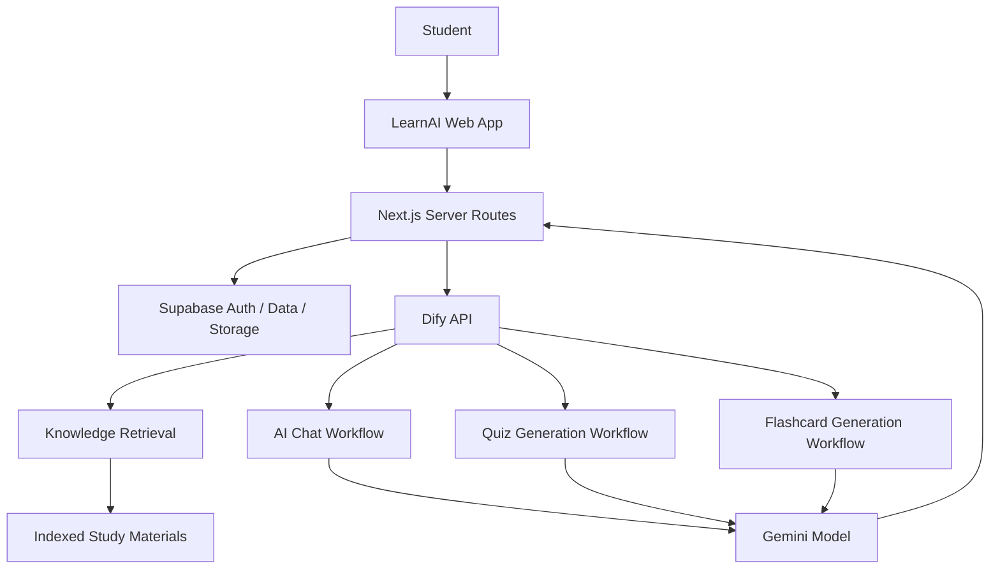

🎓 LearnAI
AI-Powered Learning Management System
Turn study materials into interactive learning experiences with document-grounded AI chat, quizzes, and flashcards.

📖 Overview
LearnAI is a web-based, AI-powered Learning Management System (LMS) designed to help students learn from their own study materials. Instead of switching between PDF readers, chatbots, and revision tools, students can work with documents and AI-assisted learning features in one place.

The platform combines Retrieval-Augmented Generation (RAG) with Dify workflows to retrieve relevant material from uploaded documents and support context-aware answers, multiple-choice quizzes, and revision flashcards.
✨ Key Features
Feature	Description
📄 Document Management	Upload and organize PDF study materials.
💬 AI Document Chat	Ask questions about uploaded material through a RAG-powered chatbot.
🧠 Quiz Generation	Generate topic-based multiple-choice questions with answers and explanations.
🗂️ Flashcard Generation	Convert key concepts into question-and-answer revision cards.
🔐 User Authentication	Manage user sessions through Supabase authentication.
🎨 Responsive Interface	Study through a modern web interface built with Next.js and Tailwind CSS.

Project status: This is an actively developed academic project. AI features require configured Dify workflows, a working embedding/model provider, and correctly indexed documents. Availability may depend on external API quotas.

🛠️ Tech Stack
Layer	Technology
Frontend	Next.js 16, React 19, TypeScript
Styling	Tailwind CSS 4, Lucide React
Backend / API	Next.js server routes
Authentication and data	Supabase
AI workflow orchestration	Dify
LLM and embeddings	Google Gemini (configured through Dify)
Retrieval approach	Retrieval-Augmented Generation (RAG)
PDF interface	React PDF

🏗️ Architecture

How document-grounded learning works
1. A student uploads a PDF through LearnAI.
2. The application stores document information and associates it with the authenticated user.
3. The document must be uploaded to and indexed in the configured Dify Knowledge Base.
4. A custom metadata field named document_id links indexed content to the corresponding Supabase document UUID.
5. Chat, quiz, and flashcard requests send the selected document_id to the relevant Dify workflow.
6. Dify retrieves relevant document chunks and uses the configured model to generate a response.
Important: The Supabase document UUID is not automatically the same as Dify's internal document ID. The metadata mapping must be configured correctly for document-specific retrieval.
📁 Repository Structure
Lms-portal/
├── Project plan and resources/   # Planning and reference materials
├── dify_workflows/              # Dify workflow definitions
├── docs/                        # Project documentation
├── public/                      # Static assets
├── scripts/                     # Project utilities
├── src/                         # Next.js application source
├── supabase/                    # Supabase-related files
├── .env.example                 # Environment variable template
├── package.json                 # Dependencies and scripts
└── README.md                    # Project documentation
🚀 Getting Started
Prerequisites
- Node.js and npm compatible with Next.js 16
- A Supabase project
- A Dify workspace with the required workflows configured and published
- Model-provider credentials configured in Dify
- A Dify Knowledge Base containing indexed study documents
1. Clone the repository
git clone https://github.com/devanshbansal3912/Lms-portal.git
cd Lms-portal
2. Install dependencies
npm install
3. Configure environment variables
Copy the example file to .env.local:
cp .env.example .env.local
On Windows PowerShell:
Copy-Item .env.example .env.local
Update .env.local with your own credentials:
NEXT_PUBLIC_SUPABASE_URL=https://your-project.supabase.co
NEXT_PUBLIC_SUPABASE_ANON_KEY=your_supabase_anon_key
SUPABASE_SERVICE_ROLE_KEY=your_supabase_service_role_key

DIFY_API_BASE_URL=https://api.dify.ai/v1
DIFY_QUIZ_API_KEY=your_quiz_workflow_api_key
DIFY_FLASHCARD_API_KEY=your_flashcard_workflow_api_key

NEXT_PUBLIC_ENABLE_MOCK_FALLBACK=false
The repository's .env.example is the reference for currently documented variables. Other integrations, such as a dedicated chatbot API key, may require additional server-side configuration depending on the deployed code.
🔒 Security: Never commit .env.local, service-role keys, or Dify API keys. Only variables explicitly intended for browser access should use the NEXT_PUBLIC_ prefix. Keep Dify requests and document-ownership checks on the server.

4. Configure Supabase and Dify
- Create or connect the Supabase project used by the application.
- Apply the relevant database configuration from the supabase/ directory as required by your setup.
- Import and publish the Dify workflows from dify_workflows/ where applicable.
- Connect the workflows' Knowledge Retrieval nodes to the intended Knowledge Base.
- Ensure indexed documents carry the custom document_id metadata matching the Supabase UUID.
- Confirm the configured Gemini model and embedding provider are available.
5. Start the development server
npm run dev
Visit http://localhost:3000.
Other commands
npm run build   # Production build
npm run start   # Run production server
npm run lint    # Run ESLint
🔌 Dify API Integration
Dify workflow apps use a server-side HTTP endpoint:
POST https://api.dify.ai/v1/workflows/run
Authorization: Bearer <WORKFLOW_API_KEY>
Content-Type: application/json
Quiz generation — example request
{
  "inputs": {
    "document_id": "your-supabase-document-uuid",
    "topic": "Operating Systems Deadlocks",
    "num_questions": 3
  },
  "response_mode": "blocking",
  "user": "authenticated-user-id"
}
Expected parsed quiz result:
{
  "title": "Assessment: Operating Systems Deadlocks",
  "questions": [
    {
      "question": "Which condition is necessary for deadlock?",
      "options": ["Mutual exclusion", "Preemption", "Unlimited resources", "Round-robin scheduling"],
      "correctAnswer": 0,
      "explanation": "Mutual exclusion is one of the necessary Coffman conditions."
    }
  ]
}
Flashcard generation — example request
{
  "inputs": {
    "document_id": "your-supabase-document-uuid",
    "topic": "Operating Systems Deadlocks",
    "num_cards": 3
  },
  "response_mode": "blocking",
  "user": "authenticated-user-id"
}
Expected parsed flashcard result:
{
  "title": "Study Deck: Operating Systems Deadlocks",
  "cards": [
    {
      "front": "What is deadlock?",
      "back": "A state in which processes wait indefinitely for resources held by one another."
    }
  ]
}
These are illustrative payloads, not live API responses. Dify commonly returns workflow output inside data.outputs.result; when that value is a JSON-encoded string, parse it before rendering. Each workflow has its own API key.

🧪 Troubleshooting
Issue	What to check
Empty quiz questions or flashcards	Inspect Dify execution logs and Knowledge Retrieval output. Verify topic relevance, indexing, dataset selection, and document_id metadata.
Chat works but quiz returns no chunks	Compare the workflows' actual dataset IDs, metadata filters, published versions, and retrieval traces.
429 RESOURCE_EXHAUSTED during PDF indexing	Gemini embedding requests may have exceeded a rate limit. Wait for the suggested retry period, then retry without duplicating the upload.
Authentication or database errors	Check Supabase credentials, policies, and required schema.
Dify API authentication errors	Verify the correct app-specific API key and server-side environment variables.

Large PDFs can generate many text chunks. Adjusting chunk size and overlap may reduce embedding work, but chunking alone does not guarantee that rate-limit errors will disappear.
🗺️ Future Improvements
- More robust background indexing and retry handling for large PDFs
- Learning progress analytics and performance insights
- Improved document-level citations and retrieval transparency
- Adaptive quiz difficulty and personalized study recommendations
- Expanded support for additional study-material formats
👥 Project Context
LearnAI is a collaborative academic project exploring practical applications of RAG, LLM workflow orchestration, and full-stack web development in education.
🤝 Contributing
Suggestions, issues, and improvements are welcome. Please open an issue to discuss substantial changes before submitting a pull request.

LearnAI — Learn smarter, revise better.

View Repository

