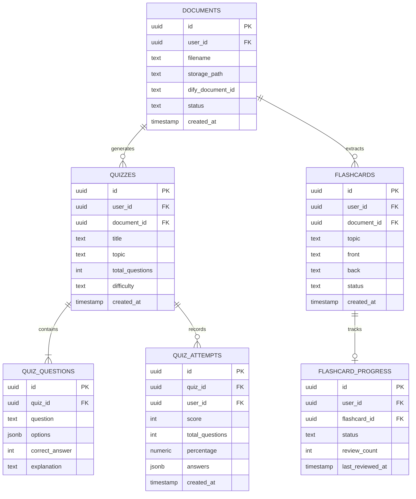

# Database Schema & Row-Level Security (RLS) Documentation

This document describes the PostgreSQL database schema for the Learning Features, Assessment Engine, and Flashcards system.

---

## 1. Entity-Relationship (ER) Diagram

---

## 2. Table Specifications

### A. `documents` (Shared with Student 1 & 2)
Tracks uploaded PDF documents and links them to Dify Knowledge Base identifiers.
- `id`: Primary Key (UUID)
- `user_id`: Owning student UUID (maps to `auth.users`)
- `filename`: User-facing document name
- `storage_path`: Path inside Supabase Storage bucket
- `dify_document_id`: The ID returned by Dify after PDF chunking and embedding
- `status`: `'UPLOADING'` | `'PROCESSING'` | `'READY'` | `'FAILED'`

### B. `quizzes`
Header record for every generated assessment quiz.
- `id`: Primary Key (UUID)
- `user_id`: Owning student UUID
- `document_id`: Foreign key referencing `documents(id)` with `ON DELETE CASCADE`
- `title`: Human-readable quiz title
- `topic`: Extracted study topic

### C. `quiz_questions`
Individual MCQs with grounded explanations and authoritative answer index.
- `id`: Primary Key (UUID)
- `quiz_id`: Foreign key referencing `quizzes(id)` with `ON DELETE CASCADE`
- `question`: Question text
- `options`: JSONB array of 4 string options: `["A", "B", "C", "D"]`
- `correct_answer`: Integer index (0, 1, 2, or 3) representing the single correct option
- `explanation`: Fact-based explanation grounded in the study material

### D. `quiz_attempts`
Authoritative server-side grading log for each attempt.
- `id`: Primary Key (UUID)
- `quiz_id`: Foreign key referencing `quizzes(id)`
- `user_id`: Student who took the quiz
- `score`: Number of correctly answered questions
- `total_questions`: Total questions in the quiz
- `percentage`: Generated stored column: `ROUND((score / total_questions) * 100, 2)`
- `answers`: JSONB object mapping `{ question_id: selected_index }`

### E. `flashcards`
Extracted concept pairs for revision.
- `id`: Primary Key (UUID)
- `user_id`: Owning student UUID
- `document_id`: Foreign key referencing `documents(id)`
- `topic`: Concept focus
- `front`: Prompt or question
- `back`: Concise explanation or answer
- `status`: `'NEW'` | `'KNOWN'` | `'NEED_REVISION'`

---

## 3. Row-Level Security (RLS) Policies
Row-Level Security is strictly enabled on all tables:
- **SELECT Policies:** Users can only query rows where `auth.uid() = user_id`.
- **INSERT Policies:** Users can only insert records tagged with their own `auth.uid()`.
- **UPDATE / DELETE Policies:** Users can only modify or delete their own data.
- **Cascading Deletes:** Deleting a document automatically removes related quizzes, questions, attempts, and flashcards cleanly without orphan records.
