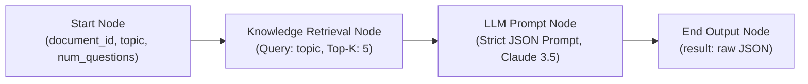
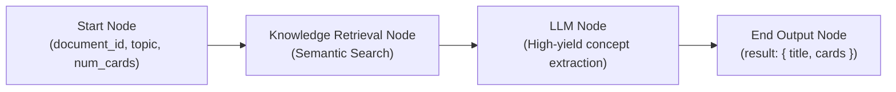

# Dify Workflow Architecture & Setup Guide

This guide explains how Student 3's two single-shot AI workflows operate and how to configure them in Dify Studio.

---

## 1. Why Single-Shot Workflow instead of Chatflow?
- **Chatflows** maintain ongoing conversation history (`conversation_id`), message memory, and multi-turn conversational state. They are ideal for Student 2's Document Chat feature.
- **Workflows** are deterministic execution DAGs that accept inputs, perform structured processing, and return an immediate single-shot structured JSON response. They are ideal for:
  1. Quiz Generation (strict 4-option JSON schema).
  2. Flashcard Extraction (concise concept-definition pairs).

---

## 2. Quiz Generation Workflow Graph



### Prompt Engineering for Schema Enforcement
To prevent the LLM from outputting conversational filler (such as *"Sure! Here are your 5 questions:"*), the prompt enforces strict formatting rules:
- **System Prompt:**
  ```text
  You are an authoritative university professor and assessment creator.
  Output ONLY valid JSON matching this schema:
  {
    "title": "Assessment: [topic]",
    "questions": [
      {
        "question": "What is ...?",
        "options": ["A", "B", "C", "D"],
        "correctAnswer": 0,
        "explanation": "..."
      }
    ]
  }
  Do not include markdown code fences or any text outside the JSON object.
  ```

---

## 3. Flashcard Extraction Workflow Graph



---

## 4. Resilience Architecture: Smart Mock Fallback
In hackathons and university evaluations, external servers and Google Colab tunnels frequently restart or time out. 
To prevent live demo failures:
1. When Next.js calls `runQuizWorkflow()` or `runFlashcardWorkflow()`, it sets a 45-second timeout controller.
2. If Dify responds with valid JSON, it parses and saves the real AI output.
3. If Dify is unreachable, times out, or reports a network error, the backend gracefully switches to **Smart Mock Mode** (`isMock: true`), returning grounded Operating Systems test material without crashing the application.
